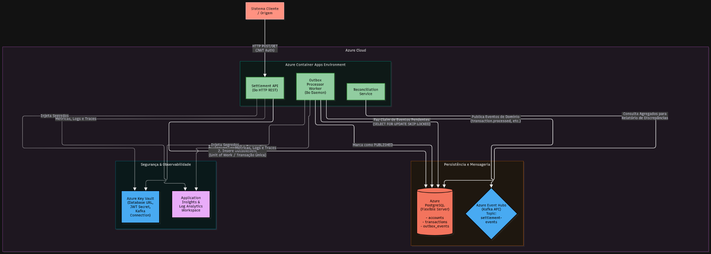

# Settlement Engine

API em Go para processamento de transferências financeiras entre contas, com
atomicidade, idempotência, concorrência otimista e eventos de domínio.

## Arquitetura



### Componentes implementados

- **Settlement API**: API HTTP/REST protegida por JWT.
- **Settlement Service**: coordena criação de contas e processamento de
  transferências.
- **Domínio**: agregados `Account`, `Transaction` e `Settlement`.
- **PostgreSQL**: persiste contas, transações e eventos da outbox.
- **Outbox Processor**: reivindica eventos pendentes e publica eventos usando
  Kafka ou Azure Event Hubs.
- **Reconciliation Service**: serviço interno para validar a consistência de
  contas e transações.
- **Azure Key Vault**: fornece segredos ao Container App por Managed Identity.
- **Azure Monitor**: Log Analytics, Application Insights e Monitor Workspace
  são provisionados pelo Terraform.

O repositório possui atualmente um único processo, `settlement-api`. O
`Outbox Processor` é executado em uma goroutine dentro da API. O serviço de
reconciliação existe no código, mas não possui rota HTTP nem agendamento
automático. Workers separados são uma evolução futura.

## Fluxo de uma transferência

```text
Cliente
  |
  v
Settlement API
  |
  v
JWT Middleware
  |
  v
Settlement Service
  |
  v
Account + Transaction + Settlement
  |
  v
Transação PostgreSQL
  ├── Atualiza contas
  ├── Persiste transações
  └── Grava eventos na outbox
          |
          v
Outbox Processor interno
          |
          v
Kafka / Azure Event Hubs
```

As alterações financeiras e os eventos da outbox são persistidos na mesma
transação PostgreSQL. Se uma etapa falhar, a operação sofre rollback.

## Funcionalidades

- Criação e consulta de contas.
- Transferências com valores em centavos.
- Idempotência por chave única.
- Concorrência otimista por controle de versão.
- Débito, crédito, compensação e eventos de domínio.
- Outbox transacional com retry e claim usando `FOR UPDATE SKIP LOCKED`.
- Publicação Kafka compatível com Azure Event Hubs usando TLS e SASL.
- Serviço de reconciliação de contas e transações.
- Health checks.
- Autenticação JWT nas rotas de negócio.
- Logs estruturados e `request_id`.

## Estrutura do projeto

```text
cmd/settlement-api/       Inicialização da API
internal/domain/          Agregados, entidades, regras e eventos
internal/application/     Serviços de aplicação, DTOs e portas
internal/infrastructure/  HTTP, PostgreSQL, outbox, Kafka e reconciliação
migrations/               Schema inicial do PostgreSQL
tests/                    Testes unitários, integração e carga
infra/azure/              Infraestrutura Azure em Terraform
scripts/                  Automação de deploy
arquitetura/              Diagramas e documentação técnica
```

## Persistência

O schema inicial cria as seguintes tabelas:

```text
accounts
transactions
settlement_ledger
outbox_events
audit_log
reconciliation_reports
```

O fluxo principal utiliza diretamente `accounts`, `transactions` e
`outbox_events`. As demais tabelas estão preparadas para ledger, auditoria e
relatórios de reconciliação.

## API

| Método | Endpoint | Descrição |
| --- | --- | --- |
| `GET` | `/health` | Retorna o status da aplicação |
| `GET` | `/readiness` | Usa o mesmo handler de `/health` atualmente |
| `GET` | `/liveness` | Usa o mesmo handler de `/health` atualmente |
| `GET` | `/api/v1/info` | Retorna nome e versão da API |
| `POST` | `/api/v1/accounts` | Cria uma conta |
| `GET` | `/api/v1/accounts/get?id={id}` | Consulta uma conta |
| `POST` | `/api/v1/transactions` | Processa uma transferência |
| `GET` | `/api/v1/transactions/get?id={id}` | Consulta uma transação |

As rotas de negócio exigem:

```http
Authorization: Bearer <token>
```

O token deve usar assinatura HMAC e conter um `sub` não vazio. O `sub` é
utilizado para autorizar operações sobre a conta do cliente.

Exemplo:

```bash
curl -X POST http://localhost:8080/api/v1/accounts \
  -H 'Content-Type: application/json' \
  -H 'Authorization: Bearer <token>' \
  -d '{"customer_id":"CUST-001","initial_balance":100000}'
```

Os valores financeiros são enviados em centavos. `100000` representa
`1000.00`.

As respostas JSON incluem `timestamp` e `request_id`. O middleware também
retorna o header `X-Request-ID`.

## Tecnologias

- Go 1.22+
- PostgreSQL 15+
- Docker e Docker Compose
- Terraform 1.6+
- Azure Container Apps
- Azure Database for PostgreSQL Flexible Server
- Azure Event Hubs com endpoint Kafka
- Azure Container Registry
- Azure Key Vault
- Log Analytics, Application Insights e Azure Monitor
- Domain-Driven Design
- Repository Pattern
- Unit of Work
- Outbox Pattern
- Concorrência otimista

## Execução local

### Pré-requisitos

- Go 1.22 ou superior
- Docker e Docker Compose

### Inicialização

O repositório não possui `.env.example`. O arquivo `.env` contém a estrutura
de configuração local; revise os valores sensíveis antes de executar:

```bash
docker compose up -d postgres
go run ./cmd/settlement-api
```

Verifique a API:

```bash
curl http://localhost:8080/health
```

O Docker Compose inicia PostgreSQL e pgAdmin. Ele não inicia um broker Kafka,
portanto a publicação de eventos exige um broker acessível ou configuração de
teste/mock.

## Configuração

A aplicação carrega `.env` automaticamente em desenvolvimento e utiliza
variáveis de ambiente no Azure. A configuração efetivamente lida pelo código
inclui:

```env
HTTP_HOST=0.0.0.0
HTTP_PORT=8080
DATABASE_URL=
DB_HOST=localhost
DB_PORT=5432
DB_USER=settlement_user
DB_PASSWORD=settlement_password
DB_NAME=settlement_engine
DB_SSL_MODE=disable
KAFKA_BROKERS=localhost:9092
KAFKA_TOPIC_EVENTS=settlement-events
KAFKA_CONNECTION_STRING=
LOG_LEVEL=info
APP_ENV=development
JWT_SECRET=generate-a-long-random-secret
```

`DATABASE_URL`, quando preenchida, tem prioridade sobre os parâmetros
`DB_*`. `KAFKA_TOPIC` também pode ser usado como alternativa a
`KAFKA_TOPIC_EVENTS`.

As variáveis de pool, consumer group, métricas, CORS e rate limit presentes no
`.env` não são consumidas pela configuração atual da aplicação.

Em produção, utilize `DATABASE_URL` com TLS ou `DB_SSL_MODE=require` e nunca
versione arquivos `.env` com credenciais reais.

## Deploy na Azure

A infraestrutura está em [infra/azure](infra/azure) e é provisionada com
Terraform. Ela cria:

- Resource Group.
- Azure Container Registry.
- Azure Container Apps Environment e Container App.
- PostgreSQL Flexible Server e banco de dados.
- Event Hubs com endpoint Kafka e tópico `settlement-events`.
- Azure Key Vault.
- Log Analytics.
- Application Insights.
- Azure Monitor Workspace.

Configure o `.env` com `AZURE_SUBSCRIPTION_ID`, `DB_PASSWORD` e `JWT_SECRET`,
autentique-se e execute:

```bash
az login
./scripts/deploy-azure.sh
```

O script:

1. Seleciona a subscription Azure.
2. Inicializa o Terraform.
3. Cria ou atualiza o Container Registry.
4. Constrói a imagem `settlement-api` com `az acr build`.
5. Aplica os recursos restantes.
6. Injeta `DATABASE_URL`, `KAFKA_CONNECTION_STRING` e `JWT_SECRET` no Container
   App usando Key Vault e Managed Identity.

O Container App possui ingress externo, porta `8080`, mínimo de uma réplica e
máximo de três. O PostgreSQL está configurado com regra de firewall pública
para `0.0.0.0`; em produção, recomenda-se VNet, Private Endpoint, Private DNS
e firewall restrito.

O Terraform ainda não possui backend remoto configurado.

## Testes

```bash
go test ./...
go vet ./...
```

O projeto contém testes de domínio, autenticação JWT, integração e carga.
Os testes de integração e carga utilizam `localhost:8080` e podem ser
ignorados quando a API não está disponível.

## Estado atual

### Implementado

- API HTTP e regras de domínio.
- Persistência PostgreSQL.
- Unit of Work para operações financeiras e outbox.
- Idempotência e concorrência otimista.
- Outbox Processor com claim transacional.
- Publicação Kafka/Event Hubs.
- Autenticação JWT.
- Serviço de reconciliação.
- Provisionamento Azure via Terraform.
- Configuração por `.env` e variáveis de ambiente.
- Logs estruturados.

### Ainda não implementado

- Worker separado da API.
- Consumer Kafka para eventos recebidos.
- Endpoint `/metrics` e métricas Prometheus.
- SDK de tracing/telemetria integrado ao Application Insights.
- Reconciliação agendada automaticamente.
- Provedores de notificação como e-mail, SMS ou push.
- Backend remoto do Terraform.
- VNet e Private Endpoints.
